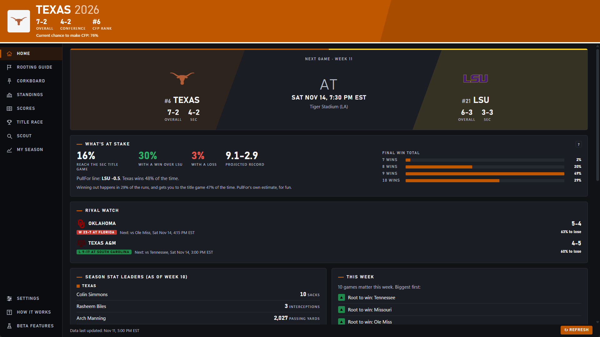
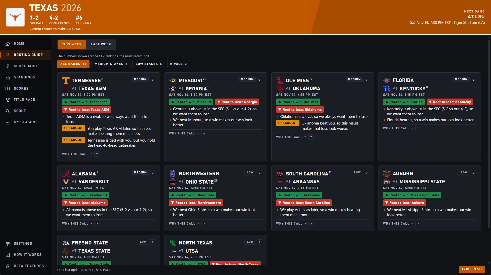
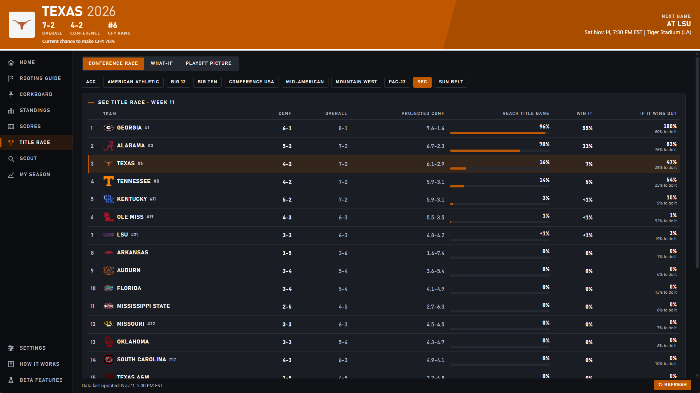
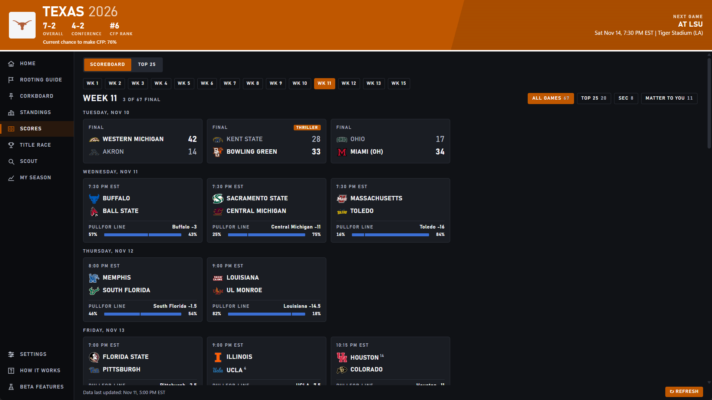
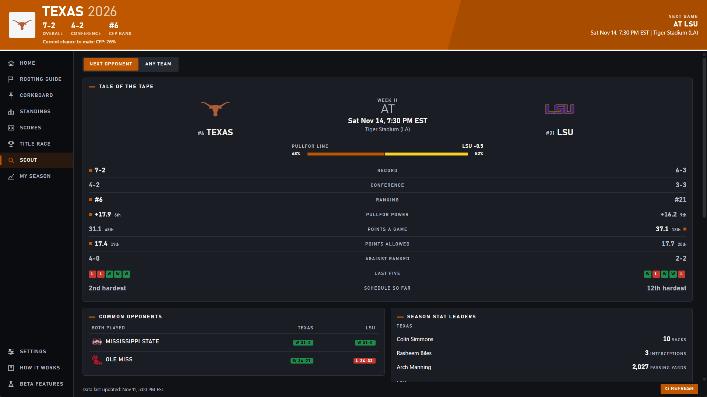
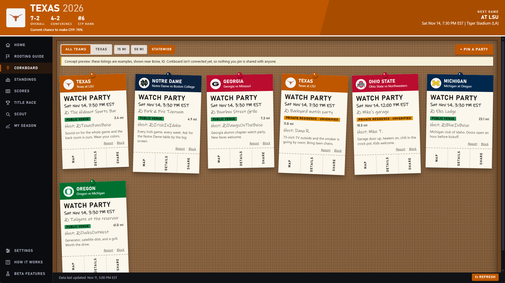
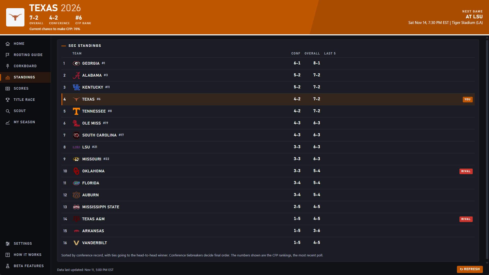
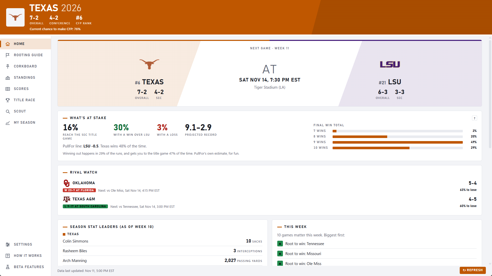

# PullFor — College Football Fan App

PullFor is a Windows desktop app for college football fans. It helps answer the weekly question: which games matter to my team, who should I root for, and why? It combines a transparent rules-based Rooting Guide, conference standings, season data, and PullFor Power, the app's own statistical model. Model estimates are shown separately from rooting calls and are not betting advice.

**Current status:** PullFor 0.6.2 (beta) was submitted to the Microsoft Store in November 2026. A mobile version is in the works.

## Desktop showcase

These 1920×1080 screenshots show the current Windows desktop app.

### Home — matchup, stakes, PullFor Power, and stat leaders

### Rooting Guide — weekly calls with the rules behind them

### Title Race — conference simulations and what-if scenarios

### Scoreboard — weekly slate, results, rankings, and PullFor estimates

### Scout — next opponent comparison

### Corkboard — concept preview

Corkboard is a concept preview, not a live community network. Listings are examples; posting, sharing, maps, reports, and blocking are not connected to a service, and nothing is shared.

### Standings

### Home in light theme

## Core features

- **Rooting Guide:** Applies PullFor's written rules to games that matter to the selected team, explains each call, and sorts games by rule-based stakes. Custom rivals are supported.
- **PullFor Power (beta):** A model fitted to this season's scores provides PullFor's own estimates for games and season scenarios. It does not change Rooting Guide calls and is not betting advice.
- **Season tools:** Home, Standings, Scoreboard, Top 25, Scout, Title Race, playoff picture, and other optional beta features help fans follow the season in one desktop app.
- **Corkboard concept:** A preview of a future tailgate and watch-party board; it is not connected or sharing live listings.

## Technical overview

The desktop screens use HTML, CSS, and JavaScript and run in Python through pywebview with Microsoft Edge WebView2. Rule logic and season calculations are separate from the screens. Official CollegeFootballData season data is published through PullFor's Cloudflare-hosted dataset; the app validates and caches data locally.

## Project status

- Windows desktop beta: 0.6.2 submitted to the Microsoft Store.
- Mobile version: in the works; this showcase currently focuses on desktop.
- Corkboard: concept preview only, not a live service.

For project inquiries, contact the development team.
