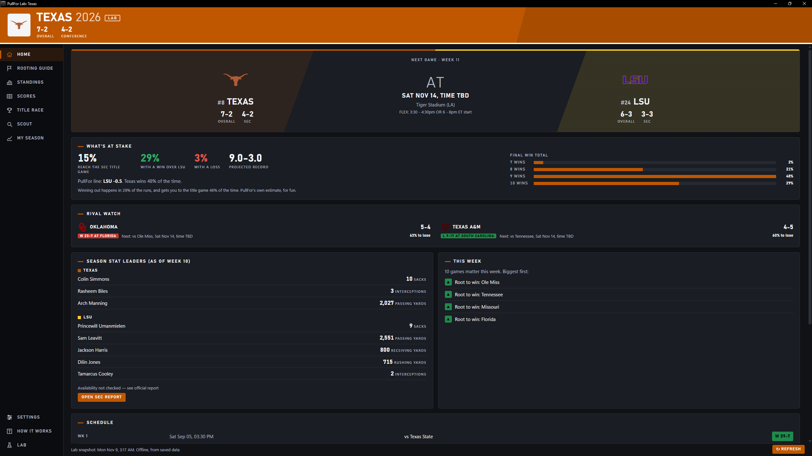
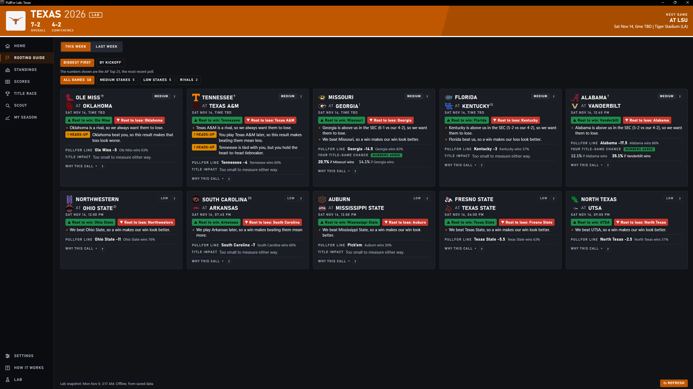
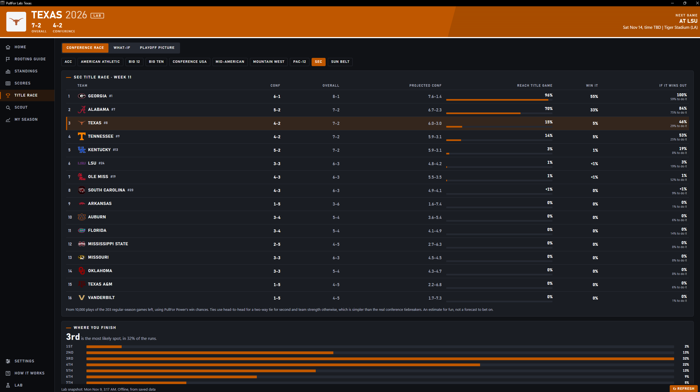
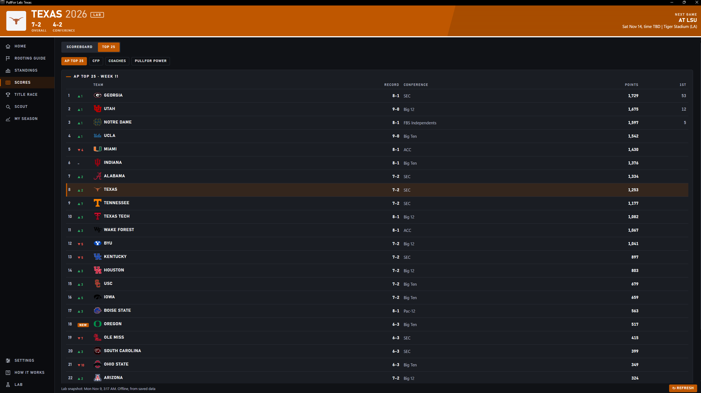
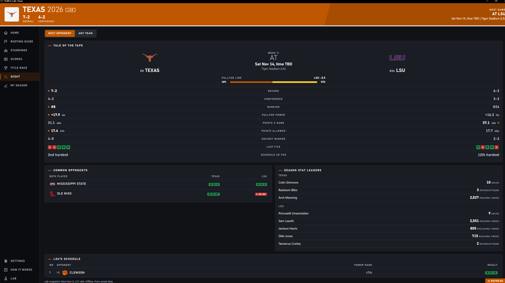

# PullFor — College Football Playoff Scenario Engine

PullFor is a desktop application and decision engine for college football fans. It synthesizes real-time season data, conference tiebreaker rules, and scenario modeling to answer the core game-day question for fans: "Which games matter to my team today, who do I root for, and why?"

---

## Interface Preview

### 1. Main Dashboard & Team Intelligence
Real-time record tracking, upcoming matchup dynamics, and primary season controls.

### 2. Rule-Based Rooting Guide
Algorithmic game ranking categorized by high, medium, and low stakes impact.

### 3. Playoff & Title Race Simulation
Simulated conference title paths, win probability swings, and scenario breakdowns.

### 4. Live Scores & Top 25 Slate
Gameday scoreboards, ranking dynamics, and custom game filters.

### 5. Opponent Scouting & Season Overview
Deep-dive opponent resume analysis, common matchups, and full season paths.

---

## Key Architecture & Features

- Rule-Based Guidance Engine: Evaluates custom rivalries, head-to-head records, conference standings, and tiebreaker conditions in priority order.
- Playoff & Title Race Simulation: Runs iterative Monte Carlo season simulations to calculate live conference championship and playoff odds.
- Stakes Scoring Framework: Weighs matchup importance mathematically without relying on betting markets or odds language.
- Local-First Performance: Built on Python with an offline-capable JSON cache, sub-second page transitions, and strict zero-API-overuse governance.

---

## Technical Stack

- Frontend / UI: HTML5 / CSS3 / JavaScript (ES6)
- Desktop Runtime: Python / pywebview (Edge WebView2)
- Database & Sync: Supabase / Local JSON Caching Layer
- Data Pipeline: CollegeFootballData API & Cloudflare Edge CDN
- Geospatial & Mapping: Mapbox API

---

## Current Project Status & Milestones

- [x] Phase 1 (MVP): Core rooting logic engine, local caching, and custom rivalry configuration.
- [x] Phase 2 (UX/UI Polish): Custom athletic design layout, dark/light themes, and window management.
- [x] Phase 3 (Lab Sandbox): Integrated Monte Carlo title race simulator, Scout profiles, and Saturday game-day tallies.
- [ ] Phase 4 (Deployment): Public Windows installer distribution and web reference portal.

---

## Grant & Project Inquiries
Note: The primary source code repository for PullFor remains in private development. This preview repository serves as a visual proof-of-concept and technical summary for grant evaluation, microgrant applications, and technical partnerships.

For further information or demonstration requests, please contact the development team.
